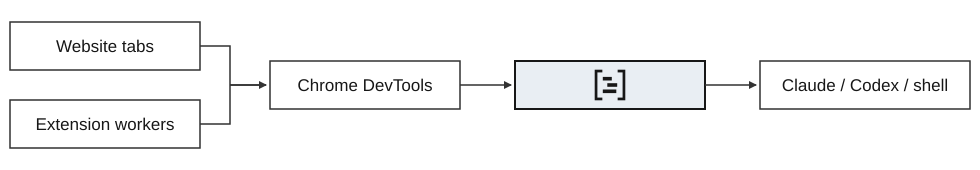

<p align="center">
  <picture>
    <source media="(prefers-color-scheme: dark)" srcset="assets/logo-dark.svg" />
    
  </picture>
</p>
<h1 align="center">Browser Network CLI</h1>

Record and inspect network requests from websites and Chrome extensions, then replay them from your terminal. Use your existing Chrome login from Claude, Codex, or a shell.

<picture>
  <source media="(prefers-color-scheme: dark)" srcset="assets/flow-dark.svg" />
  
</picture>

## Install

Requires **Node.js 22.12+** and Chrome. npmjs publication is pending. Install the compiled package from [Releases](https://github.com/fcakyon/browser-network-cli/releases):

```sh
gh release download v0.1.0 --repo fcakyon/browser-network-cli --pattern '*.tgz'
npm install -g ./fcakyon-browser-network-cli-0.1.0.tgz
```

## Use

Enable remote debugging at `chrome://inspect/#remote-debugging`. On macOS:

```sh
browser-network start \
  --profile "$HOME/Library/Application Support/Google/Chrome" \
  --host example.com

browser-network tail        # Follow live requests
browser-network requests    # Find a request ID
browser-network show 12     # Inspect its details
browser-network stop        # Leave Chrome running
```

Add `--extension ID` to capture an extension's background requests. Add `--sensitive` to retain cookies, authorization headers, and bodies. Replay requires `browser-network replay ID --execute` and sends a real request.

Capture is scoped to the hosts you select. Data stays in memory until stopped.

[Usage and limitations](docs/usage.md) · [Releases](https://github.com/fcakyon/browser-network-cli/releases) · [MIT license](LICENSE)

Built on [chrome-remote-interface](https://github.com/cyrus-and/chrome-remote-interface).
